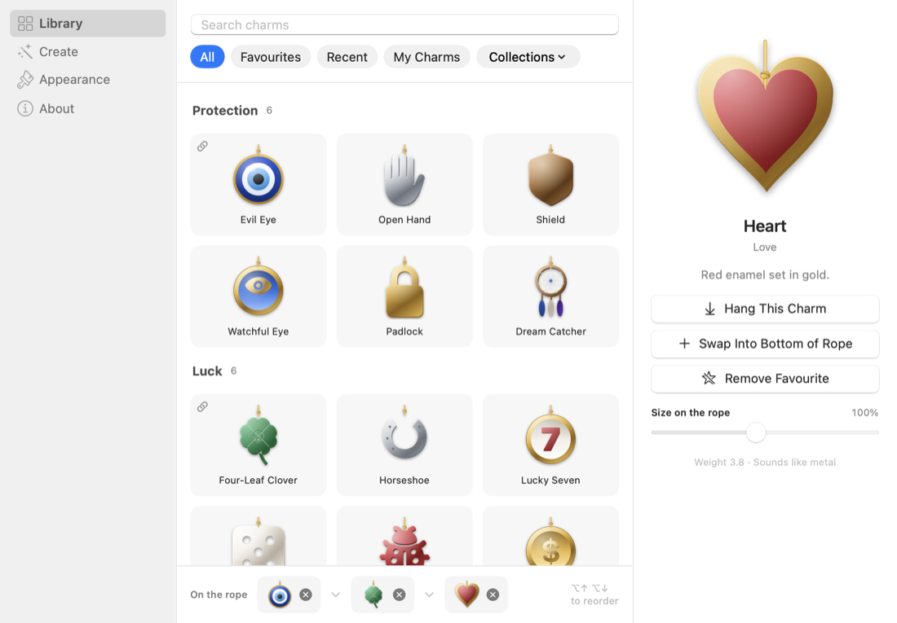
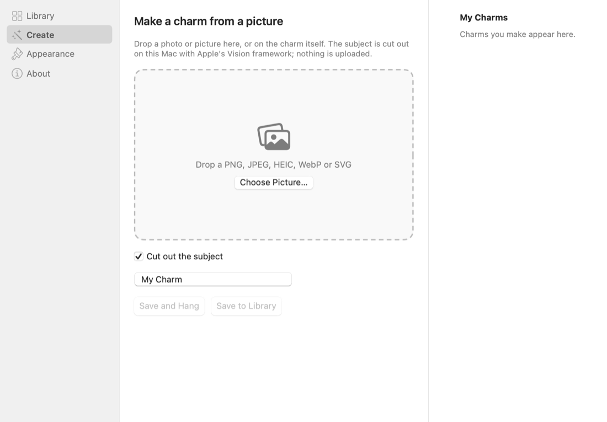
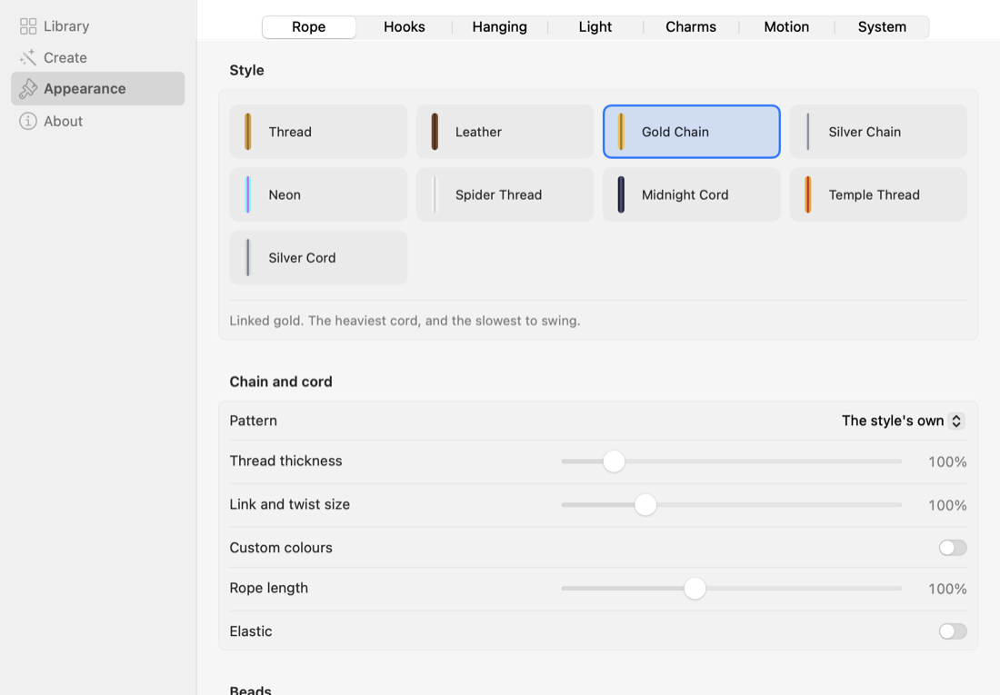
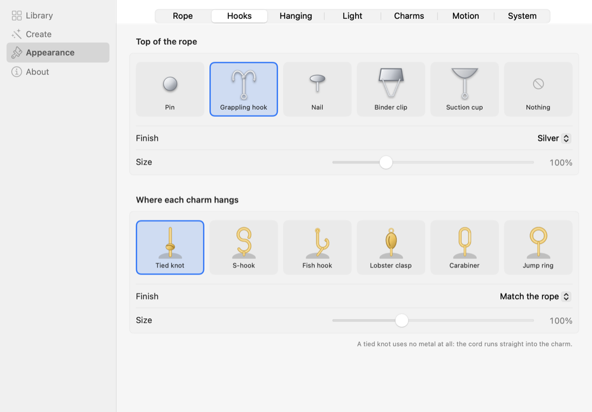
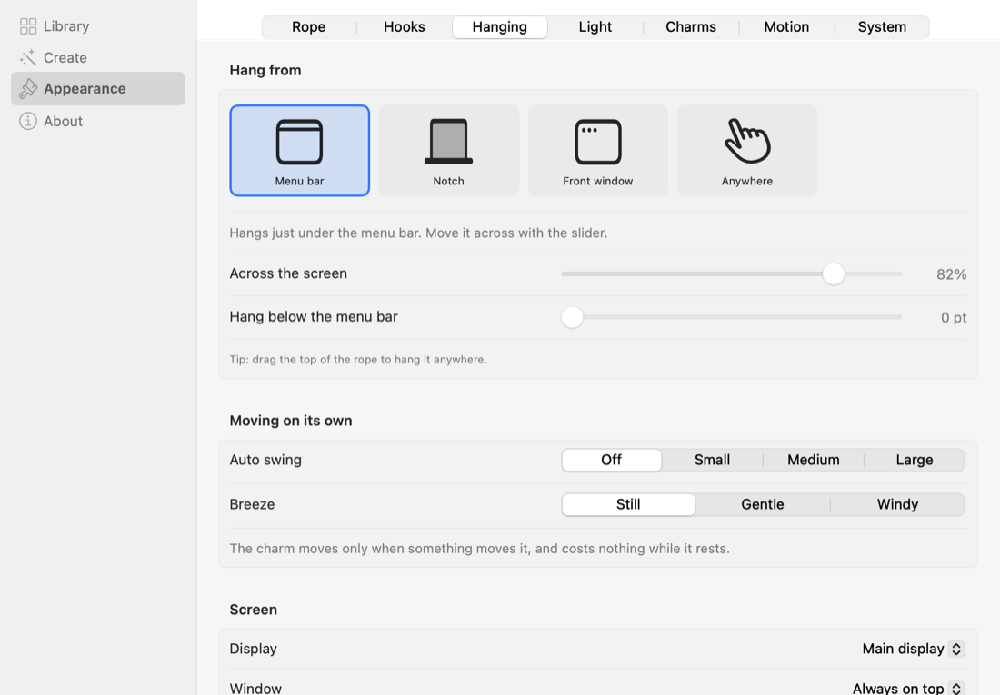
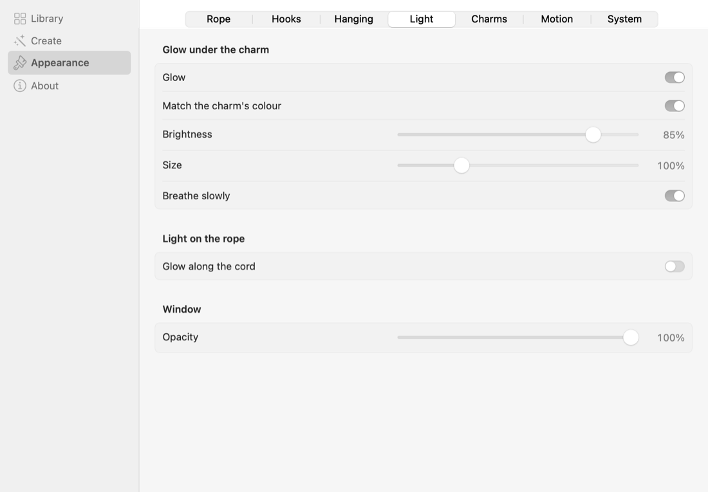
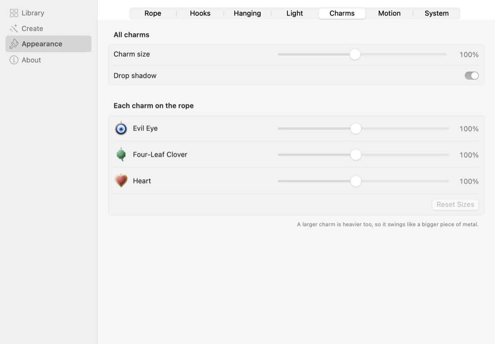
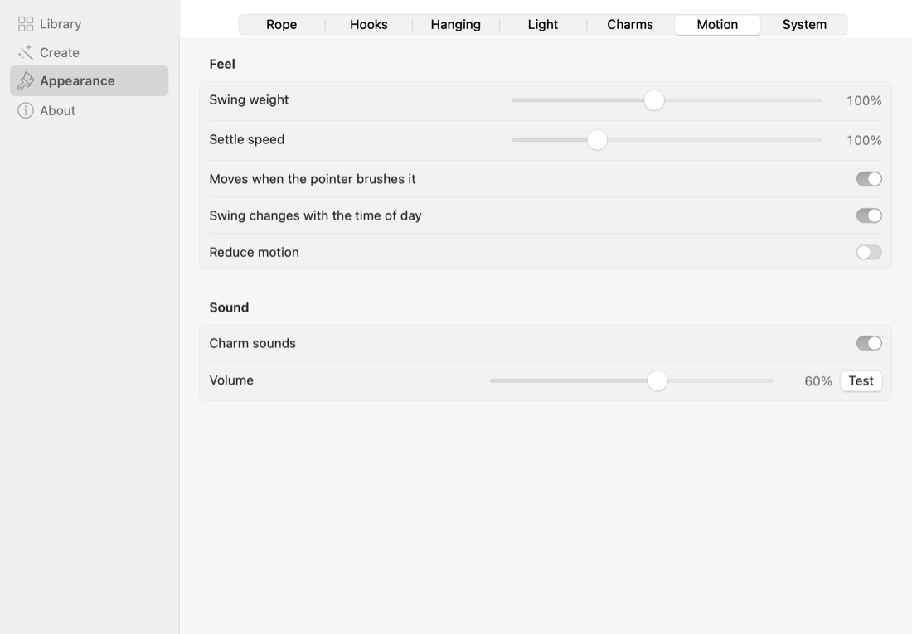
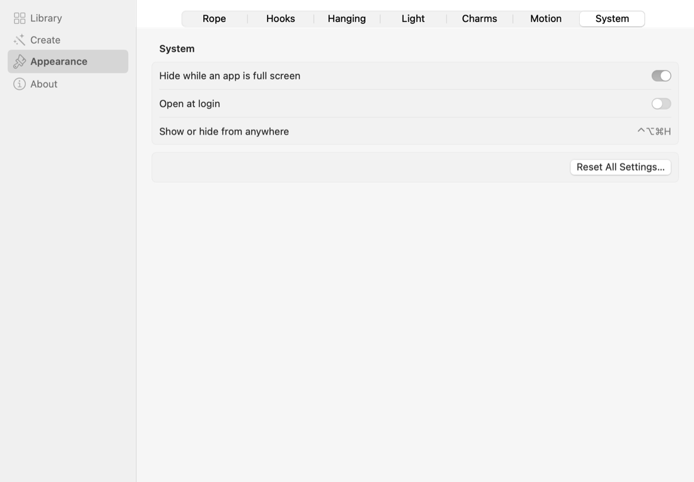

# How to use Hanging Charms

Hanging Charms puts a charm on a rope on your Mac's desktop. You can grab it, throw it,
dress it up and hang it wherever you like. This guide walks through everything it does.

- [Getting started](#getting-started)
- [Playing with the charm](#playing-with-the-charm)
- [The menu bar menu](#the-menu-bar-menu)
- [Choosing charms in the Library](#choosing-charms-in-the-library)
- [Making your own charm](#making-your-own-charm)
- [Appearance](#appearance)
- [Keyboard shortcuts](#keyboard-shortcuts)
- [Troubleshooting](#troubleshooting)
- [Removing Hanging Charms](#removing-hanging-charms)

---

## Getting started

1. Download **HangingCharms-1.x.x.zip** from the
   [latest release](https://github.com/Patlu29/hanging-charms-macos/releases/latest),
   unzip it, and drag **Hanging Charms.app** into **Applications**.
2. Open it. The app is not notarised by Apple, so macOS stops it the first time:
   - **macOS 15 Sequoia and later:** click **Done**, open **System Settings ›
     Privacy & Security**, scroll down, click **Open Anyway** next to Hanging Charms and
     confirm.
   - **macOS 14 Sonoma:** Control-click the app, choose **Open**, then **Open** again.
3. A charm drops in near the top right of your screen and swings. The first time, the
   Library opens too, so you can pick a different charm straight away.

Hanging Charms lives in the **menu bar** (look for the small charm icon near the clock).
It has no Dock icon. Opening the app again from Finder or Spotlight shows the Library.

It needs no permissions and never connects to the internet.

## Playing with the charm

| To | Do this |
|---|---|
| Swing it | Click and hold the charm, move the pointer, then let go. It carries on at the speed you threw it. |
| Knock it | Flick the pointer quickly through the charm. A slow approach does not move it, so you can always catch it. |
| Move where it hangs | Drag the top of the rope (the grapple) and drop it anywhere. It stays pinned there. |
| Open the Library | Double-click the charm. |
| Quick options | Right-click the charm for the Library, Create, Appearance, the rope, where it hangs, auto swing, breeze, and Hide. |
| Make a charm from a photo | Drop a picture file onto the charm. |

Clicks anywhere else go straight through to whatever is underneath, so the charm never
gets in the way of your work.

## The menu bar menu

Click the charm icon in the menu bar:

| Item | What it does |
|---|---|
| **Hide Charm / Show Charm** | Hides or shows it. Also ⌃⌥⌘H from any app. |
| **Library…** | Pick charms. |
| **Create a Charm…** | Make one from a picture. |
| **Appearance…** | Every look and motion setting. |
| **Rope** | Switch between the nine ropes. |
| **Hang From** | Menu bar, Notch, Front window or Anywhere. |
| **Auto Swing** | Off, Small, Medium or Large. |
| **Breeze** | Still, Gentle or Windy. |
| **Charm Sounds** | Chimes when charms knock together. |
| **Open at Login** | Start Hanging Charms when you log in. |
| **About Hanging Charms** | Version and credits. |
| **Quit Hanging Charms** | Closes the app. |

## Choosing charms in the Library



The Library has 154 charms in 16 collections: Protection, Luck, Celestial, Nature, Love,
Spirit, Classics, Animals, Zodiac, Birthstones, Celebration, Food and Drink, Travel,
Sports and Hobbies, Weather and Initials, plus any you make yourself.

- **Browse:** **All** shows every charm under its collection's heading. Use the
  **Collections** menu to jump to one.
- **Search:** type in the search field (⌘F). It matches names, collections and
  descriptions, so "March" finds the March birthstone and "letter k" finds K.
- **Favourites and Recent:** star a charm with **Favourite** (⌘D); recently hung charms
  appear under **Recent**.
- **Select** a charm to see it large on the right.

### Putting charms on the rope

A rope holds up to **three charms**.

| Button | What it does |
|---|---|
| **Hang This Charm** | Replaces everything on the rope with this charm. Double-clicking a tile does the same. |
| **Add to Rope** | Adds it below the charms already there. When the rope is full, it becomes **Swap Into Bottom of Rope**. |
| **Size on the rope** | Makes this charm bigger or smaller than the others (50% to 160%). Bigger charms are heavier, so they swing like a bigger piece of metal. |

The **On the rope** strip at the bottom shows what is hanging, from the top down. Click
one to select it, press ⌥↑ or ⌥↓ to move it up or down the rope, or click ⓧ to take it
off.

Tip: the **Initials** collection lets you spell a short name or a set of initials, three
letters to a rope.

## Making your own charm



1. Open **Create** (⌘2), then drop a picture on the dashed area or click
   **Choose Picture…**. You can also drop a picture straight onto the hanging charm.
   PNG, JPEG, HEIC, WebP, TIFF, GIF, SVG and PDF all work.
2. Leave **Cut out the subject** on to lift the main subject (a pet, a person, an
   object) out of its background. This happens on your Mac with Apple's Vision
   framework; nothing is uploaded. If it cannot find a clear subject, it uses the whole
   picture and says so.
3. Give it a name.
4. Click **Save and Hang** to put it on the rope now, or **Save to Library** to keep it
   for later.

Your charms appear under **My Charms** on the right and in the Library. Delete one from
either place. Photos work best with one clear subject against a contrasting background.

## Appearance

Open **Appearance** (⌘3). It has seven tabs. Every change applies to the charm straight
away and is remembered.

### Rope



- **Style:** nine ropes, each with its own physics. A gold chain is heavy and slow; a
  spider thread is light and quick; neon has a little give; leather settles soonest.
- **Pattern:** the style's own look, or twisted, braided, chain links, lit filament or
  fine silk on any rope.
- **Thread thickness:** from a quarter of the style's width up to six times it.
- **Link and twist size:** how long each chain link or twist is.
- **Custom colours:** pick a main and a detail colour. **Use the style's colours** puts
  them back.
- **Rope length:** 50% to 180%.
- **Elastic:** the cord gives when you pull it, up to half again its length.
- **Beads:** none, a few or many, with their own colour and size. They ride the rope
  above the first charm.

### Hooks



- **Top of the rope:** what the rope hangs from: a grappling hook (the default), pin,
  nail, binder clip, suction cup, or nothing.
- **Where each charm hangs:** how each charm joins the rope: a tied knot (the default,
  no metal), S-hook, fish hook, lobster clasp, carabiner or jump ring.
- Each has a **Finish** (match the rope, gold, silver, rose gold, bronze or black) and
  a **Size**.

### Hanging



**Hang from** decides where the top of the rope is:

| Choice | Where it hangs |
|---|---|
| **Menu bar** | Just under the menu bar. Set **Across the screen** and **Hang below the menu bar**. |
| **Notch** | Under the camera notch on a MacBook that has one; the middle of the menu bar on other displays. |
| **Front window** | From the top edge of whichever window is in front. Move the window and the charm swings. Set **Across the window**. |
| **Anywhere** | Wherever you drop the grapple. Fine-tune with **Across** and **Down**. |

Dragging the top of the rope always switches to **Anywhere** and pins it where you let go.

**Moving on its own:**

- **Auto swing:** a steady swing back and forth, like a clock pendulum (Small, Medium
  or Large). Push or throw the charm and it settles back into the rhythm.
- **Breeze:** soft, uneven gusts (Gentle or Windy).

With both off, the charm rests completely and uses no processor time. With either on,
it uses a little, and runs at a lower frame rate to keep that small.

**Screen:** choose which **Display** the charm hangs on, and whether the **Window** is
**Always on top** or **On the desktop** (behind your other windows).

### Light



- **Glow** under the bottom charm, in the charm's own colour or one you pick, with
  **Brightness**, **Size** and a slow **Breathe**.
- **Glow along the cord:** a soft halo around the rope itself.
- **Opacity:** how solid the whole charm is, from 30% to 100%.

### Charms



- **Charm size:** every charm at once.
- **Drop shadow:** on or off.
- **Each charm on the rope:** its own size. **Reset Sizes** puts them all back to 100%.

### Motion



- **Swing weight:** higher feels heavier and swings faster.
- **Settle speed:** higher comes to rest sooner.
- **Moves when the pointer brushes it:** quick flicks knock the charm.
- **Swing changes with the time of day:** mornings swing longer and wider; nights settle
  sooner.
- **Reduce motion:** the charm hangs still and only moves when you move it. Auto swing
  and breeze stop.
- **Charm sounds** and **Volume**, with a **Test** button.

### System



- **Hide while an app is full screen:** gets out of the way of videos, games and
  presentations.
- **Open at login.**
- **Show or hide from anywhere:** ⌃⌥⌘H.
- **Reset All Settings…:** puts everything back as it started. Your own charms stay in
  the Library.

## Keyboard shortcuts

| Shortcut | Does |
|---|---|
| ⌃⌥⌘H | Show or hide the charm, from any app |
| ⌘1 · ⌘2 · ⌘3 · ⌘4 | Library · Create · Appearance · About |
| ⌘F | Search the Library |
| ⌘D | Favourite the selected charm |
| ⌥↑ / ⌥↓ | Move the selected charm up or down the rope |
| ⇧⌘O | Show or hide the charm (in the Customize window) |
| ⌘W | Close the window |
| ⌘Q | Quit (while the Customize window is in front) |

## Troubleshooting

**"Hanging Charms can't be opened" or "Apple could not verify…"**
The app is not notarised. See [Getting started](#getting-started) step 2, or run:

```bash
xattr -dr com.apple.quarantine "/Applications/Hanging Charms.app"
```

**I can't see the charm.**
- Press ⌃⌥⌘H, or choose **Show Charm** from the menu bar icon.
- An app may be full screen: the charm hides until you leave full screen (turn off
  **Hide while an app is full screen** in Appearance › System to keep it).
- It may be on another display: check Appearance › Hanging › **Display**.
- **Window** may be **On the desktop**, which puts it behind your windows.
- **Opacity** may be low: Appearance › Light.

**The charm doesn't move on its own, or a flick does nothing.**
macOS's own Reduce Motion is probably on (System Settings › Accessibility › Display ›
Reduce motion). Hanging Charms respects it: auto swing, breeze and pointer flicks stop,
but you can still grab and throw the charm. Also check **Reduce motion** in
Appearance › Motion.

**Front window mode hangs from the menu bar.**
It hangs from the menu bar until it finds a window in front. After that, while Hanging
Charms' own window or an app with no open windows is in front, it stays on the last window
it found. Click another app's window to move it there.

**Open at Login doesn't stick.**
Move the app into **Applications** first, then turn it on again. You can also check
System Settings › General › Login Items.

**No sound.**
Turn on **Charm Sounds** in the menu bar menu and raise **Volume** in Appearance ›
Motion. Chimes play when stacked charms knock together and when you pick a charm up.

**Something looks wrong after experimenting.**
Appearance › System › **Reset All Settings…**.

## Removing Hanging Charms

1. Turn off **Open at Login** in the menu bar menu.
2. Choose **Quit Hanging Charms**.
3. Drag **Hanging Charms** from Applications to the Bin.

To also remove your settings and the charms you made, run these in Terminal:

```bash
defaults delete com.hangingcharms.mac
```

```bash
rm -rf ~/Library/Application\ Support/HangingCharms
```

---

Something not covered here? [Open an issue](https://github.com/Patlu29/hanging-charms-macos/issues).
