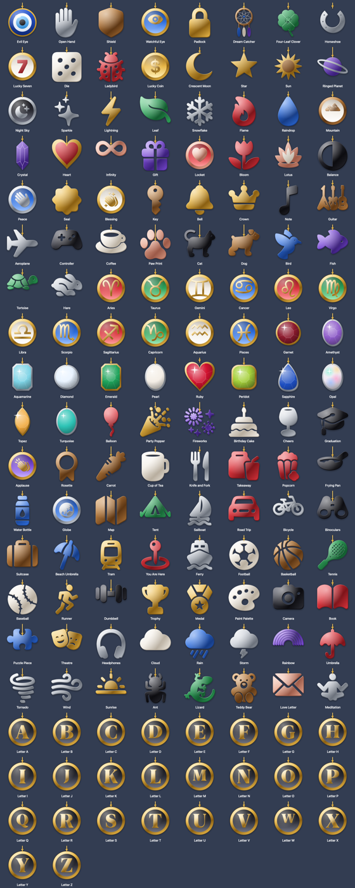
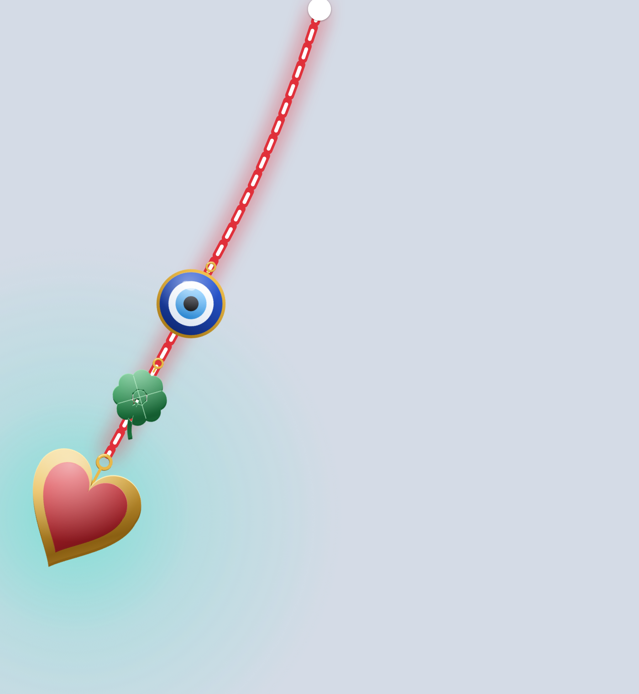
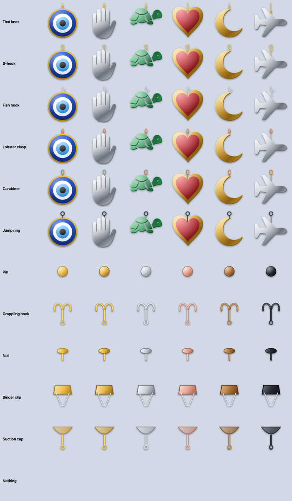

# Hanging Charms for macOS

**Charms hang from a rope on your desktop.** Push one and it swings, with the weight and
settle of a real one.

A native macOS app in Swift 6, SwiftUI and AppKit, for macOS 14 Sonoma or later, on Apple
silicon and Intel. It lives in the menu bar, has no Dock icon, needs no permissions and
never touches the network.





## Features

- **154 charms in 16 collections**: protection, luck, celestial, nature, love, spirit,
  classics, animals, zodiac, birthstones, celebration, food and drink, travel, sports and
  hobbies, weather, and initials A to Z. Search them, favourite them, see what you hung
  recently. Every charm is drawn at run time in metal, enamel or cut gemstone; there are
  no bitmap assets.
- **Up to three charms on one rope**, in any order. Each adds its own weight and its own
  stretch of cord, and stacked charms never pass through each other.
- **Nine ropes, each with its own physics.** A gold chain is heavier and slower than a
  spider thread because its solver values differ, not just its picture.
- **Real physics.** Twenty segments solved with Verlet integration at a fixed 240 Hz,
  whatever the display refresh rate. The rope never stretches past its ceiling, even
  under a hard throw.
- **Make your own.** Drop a photo (PNG, JPEG, HEIC, WebP, SVG or PDF) on the hanging
  charm, or use **Create**. Apple's Vision framework cuts the subject out on your Mac.
- **Hang it anywhere.** From the menu bar, the camera notch, the top of the front window
  (it swings when you move the window), or any spot you drag the top of the rope to.
- **Hooks and grapples.** Each charm hangs from a tied knot, S-hook, fish hook, lobster
  clasp, carabiner or jump ring; the rope hangs from a grappling hook, pin, nail, binder
  clip or suction cup. Every one in gold, silver, rose gold, bronze, black or the rope's
  own colour.
- **Make it yours.** Rope colours, thread thickness (25% to 600%), pattern, link size and
  beads; glow colour, brightness and size; a size for each charm on the rope; swing
  weight, settle speed, and a gentle or windy breeze.
- **Motion and mood.** Elastic and pointer-reactive ropes, swing that changes with the
  time of day, a breathing glow, and synthesised charm chimes.
- **Out of the way.** Click-through everywhere but the charm; always on top or on the
  desktop; hides while an app is full screen; idles at near-zero CPU once the rope
  settles, because the frame loop stops.

## Installing

1. Download **HangingCharms-1.1.0.zip** from the
   [latest release](https://github.com/Patlu29/hanging-charms-macos/releases/latest).
2. Unzip it and drag **Hanging Charms.app** into **Applications**.
3. Open it. The app is not notarised by Apple, so macOS blocks it the first time:
   - **macOS 15 Sequoia and later:** click **Done**, open **System Settings › Privacy &
     Security**, scroll down, click **Open Anyway** next to Hanging Charms, and confirm.
   - **macOS 14 Sonoma:** Control-click the app, choose **Open**, then **Open** again.

   Or clear the download flag in Terminal, then open it normally:

```bash
xattr -dr com.apple.quarantine "/Applications/Hanging Charms.app"
```

It runs on macOS 14 or later, on Apple silicon and Intel. Click the charm icon in the menu
bar for the menu; opening the app again shows the Library. To remove it, quit it from the
menu and move it to the Bin.

## Using it

**New to Hanging Charms? Read the [guide to using it](Docs/USAGE.md):** getting started,
the Library, making your own charm, every Appearance option, hanging points,
troubleshooting and removing the app.

The short version:

- **Grab** a charm and throw it. **Double-click** it to open the Library.
- **Flick** the pointer quickly through a charm to knock it; a slow approach lets you
  pick it up instead.
- **Drag the top of the rope** to hang it somewhere else.
- **Right-click** it for the Library, Create, Appearance, the rope, where it hangs, auto
  swing, breeze, or Hide.
- **Drop a picture** on it to make a charm of your own.

| Shortcut | Does |
|---|---|
| ⌃⌥⌘H | Show or hide the charm, from any app |
| ⌘1 · ⌘2 · ⌘3 · ⌘4 | Library · Create · Appearance · About |
| ⌘F | Search the Library |
| ⌘D | Favourite the selected charm |
| ⌥↑ / ⌥↓ | Move the selected charm up or down the rope |
| ⇧⌘O | Show or hide the charm |
| ⌘W | Close the window |

## Building from source

You need Xcode 16 or later (Swift 6). No Xcode project is needed.

```bash
git clone https://github.com/Patlu29/hanging-charms-macos.git
cd hanging-charms-macos
```

```bash
swift test
```

```bash
./scripts/build-app.sh
```

The app and a zip land in `dist/`. For a quick debug run, `swift run HangingCharms`.

Diagnostic renders, useful without Screen Recording permission:

```bash
swift run HangingCharms --render-catalogue catalogue.png
```

```bash
swift run HangingCharms --render-scene scene.png goldChain
```

```bash
swift run HangingCharms --render-customize appearance customize.png hooks
```

```bash
swift run HangingCharms --render-hooks hooks.png
```

And an end-to-end check of the real overlay, driven by synthetic mouse events:

```bash
swift run HangingCharms --self-test
```



## How it is put together

```
Sources/HangingCharmsCore   Foundation and CoreGraphics only; fully unit-tested
  Physics/                  Verlet solver, constraints, stretch ceiling, charm stacks
  Models/                   rope styles, time-of-day profiles, the charm catalogue
  Settings/                 AppSettings with tolerant decoding, overlay placement
  Audio/                    chime synthesis from decaying partials
Sources/HangingCharms       the macOS head
  Overlay/                  click-through NSPanel, display-link loop, layer renderer
  Charms/                   artwork renderer, custom charm library, Vision import
  Customize/                SwiftUI Library, Create, Appearance and About
  Services/                 settings store, audio, launch at login, hot key, full screen
  App/                      composition root, menu bar item, diagnostics
Tests/HangingCharmsCoreTests
```

Dependencies point inward: the core knows nothing of AppKit, which is what lets "the rope
never stretches beyond its ceiling" be a test rather than an opinion about a screenshot.

**Step order per 1/240 s slice:** pin the anchor, integrate (damped Verlet plus gravity),
drive the held charm at a bounded speed, relax link and charm-separation constraints by
Gauss-Seidel until converged, then enforce the stretch ceiling. On the rare frame a
bowed, taut rope cannot relax within budget, a FABRIK pass between the anchor and the
held charm, then a top-down follow-the-leader pass, make the ceiling exact.

**Click-through.** The panel ignores the mouse until a global mouse-moved monitor sees the
pointer over a charm, then accepts it for the grab. Mouse-moved monitoring needs no
Accessibility permission. Full-screen detection reads window bounds from CGWindowList,
which needs no Screen Recording permission; window titles are never read.

## Progress

Work is tracked in [issues](https://github.com/Patlu29/hanging-charms-macos/issues) under
the **v1.0 macOS MVP** and **v1.1 Customisation and release** milestones, one issue per
part, each closed by the commit that delivered it. See [CHANGELOG.md](CHANGELOG.md).

## Credits

The rope solver's design follows the one documented in
[Hangly for Windows](https://github.com/SharanCreatedThis/Hangly-Windows) by
sharancreatedthis (MIT). Hanging Charms is an independent implementation and uses none of
Hangly's artwork, name, icon or branding. See [NOTICE.md](NOTICE.md).

## Licence

[MIT](LICENSE).
